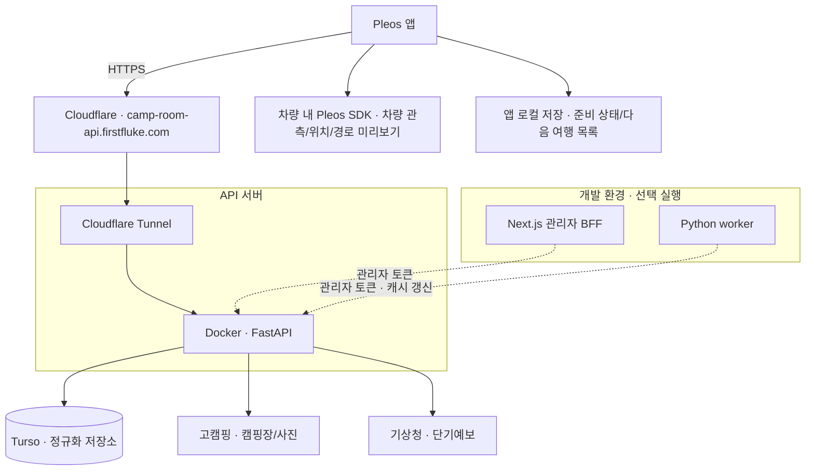
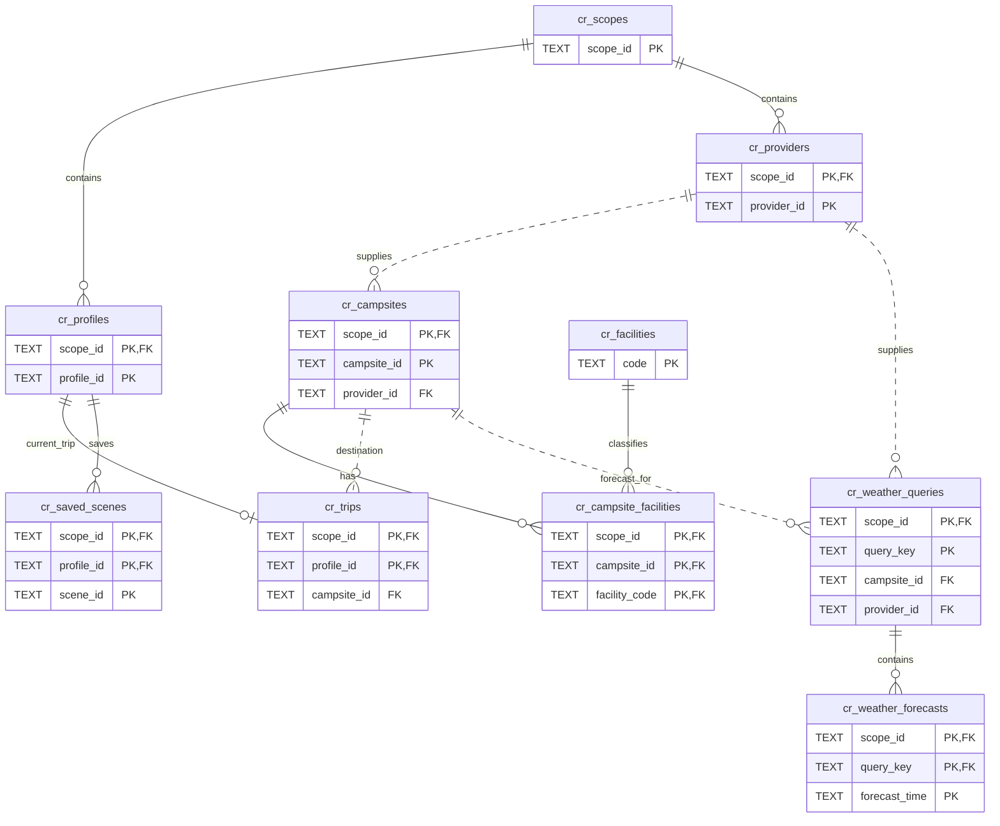

# Camp Room · 캠프룸

캠프룸은 Pleos 차량의 큰 화면에서 캠핑장을 찾고, 여행 일정과 준비물을 정리하며 차량 상태를 확인하는 Kotlin·Jetpack Compose 앱입니다. **찾기 · 내 캠핑 · 차박** 메뉴를 제공합니다.

[실행 방법](#실행-방법) · [서버 구성](#서버-구성) · [ERD](#erd) · [테스트](#테스트) · [제출 APK](apk/README.md)

## 주요 기능

- **찾기:** 지역·날짜·인원·시설로 캠핑장을 검색하고 내 주변 장소, 사진과 상세 정보를 확인합니다.
- **내 캠핑:** 장소·일정 저장과 시간별 예보, 도착→체류→출발의 준비 체크, 다음 여행에 쓸 준비물·식사 목록을 제공합니다.
- **차박:** 배터리·실내 온도 등 Pleos SDK의 차량 관측을 출처·갱신 시각과 함께 보여주고 취침·출발 준비를 안내합니다.
- **식사와 준비물:** 삼겹살·소고기·갈비·바비큐 모둠의 메뉴 사진, 구성·인분 안내와 준비 체크리스트로 식사와 짐을 정리합니다.
- **화면:** 접고 펼칠 수 있는 오른쪽 메뉴, 한국어·영어, 주야간 테마, 큰 글씨와 화면 폭에 맞춘 배치를 지원합니다.

고캠핑의 캠핑장 정보·사진과 기상청 예보를 여행 일정에 연결해 장소 선택부터 현장 준비까지 한 화면에서 이어갑니다.

| 여행 단계 | 준비 흐름 |
| --- | --- |
| 도착 | 이용 수칙·전원 계획·인원에 맞는 준비물 확인 |
| 체류 | 실내 환경·전원 사용·식사와 보관 준비 |
| 출발 | 케이블·짐·문·창문·주변 정리 체크 |
| 다음 여행 | 선택한 준비물·식사를 가져와 새 체크로 시작 |

## 데모

- [앱 화면 중심 한국어 데모](https://youtu.be/l5kq60xsgjM)
- [Pleos 차량 화면을 함께 담은 한국어 데모](https://youtu.be/Q2W0VcyVS6E)
- [서명 릴리스 APK](<apk/FIRST FLUKE_캠프룸_release.apk>) · [제출 경로와 파일 정보](apk/README.md)

앱 화면 데모는 `5e9ee30` 버전으로 촬영했습니다. 제출용 릴리스 파일과 식별 정보는 APK 안내에서 확인할 수 있습니다. 문서의 표기 시간은 서울(Asia/Seoul, KST)을 기준으로 합니다.

## 실행 환경

| 항목 | 환경 / 범위 |
| --- | --- |
| Android 앱 | JDK 17, Gradle 8.11.1, AGP 8.9.2, Kotlin 2.1.20, compileSdk/targetSdk 35 |
| Pleos 런타임 | 공식 Pleos Connect v2.1.0, Android 14/API 34 ARM64 에뮬레이터, cold boot, RAM 4GB, minSdk 28 |
| API·worker | Python 3.14 이상, uv, FastAPI, SQLite 또는 선택적 Turso |
| 관리자 웹 | Bun workspaces, Node.js 24, Next.js |
| 데이터 | 고캠핑·기상청 실응답 및 두 페이지 이상 목록, 사진·예보 표시를 로컬에서 검증 |
| SDK | Vehicle 2.3.2, vehicle-data 1.1.11, NaviHelper 3.0.5, FusedLocation 1.1.3, STT/TTS 3.3.1 |

Pleos SDK의 차량 관측·위치·경로 미리보기를 앱의 여행 흐름에 연결합니다. 화면 생명주기와 요청 세대를 관리해 현재 여행에 해당하는 응답을 반영합니다.

`pleos` flavor는 차량 내 Pleos SDK에 연결하고, `demo` flavor는 일반 Android 에뮬레이터에서 UI를 개발하는 데 사용합니다. 전용 이미지와 SDK는 공식 Pleos 배포 경로에서 준비합니다.

## 실행 방법

### 1. 도구와 의존성 준비

비공개 저장소 접근 권한, mise, Android SDK 35와 Platform Tools가 필요합니다. 아래 명령은 저장소 루트에서 실행합니다. mise가 JDK 17·Python 3.14·uv·Bun·Node.js를 관리하며, Python 의존성은 uv workspace, 웹 의존성은 Bun workspaces로 설치합니다.

```bash
git clone git@github.com:first-fluke/camp-room.git
cd camp-room
mise install --monorepo
mise run install
cp -n .env.example .env
```

이미 저장소와 `.env`가 있으면 복제·복사 단계는 건너뜁니다. API·관리자·worker는 루트 `.env`를 읽으며 이미 설정된 프로세스 환경변수를 우선합니다. 실제 값은 로컬 비공개 설정이나 서버의 비밀 저장소에만 둡니다.

| 변수 | 용도 |
| --- | --- |
| `CAMP_DATA_MODE` | `demo`는 예시 데이터, `live`는 실제 공급자만 사용, `auto`는 공급자 실패 시 예시 대체가 가능한 개발 모드 |
| `GOCAMPING_SERVICE_KEY` | 공공데이터포털 고캠핑 활용신청 키 |
| `KMA_SERVICE_KEY` | 공공데이터포털 기상청 단기예보 키 |
| `KMA_API_HUB_KEY` | 기상청 API허브용 키; 포털 방식은 `KMA_SERVICE_KEY` 사용 |
| `CAMP_DB_PATH` | 독립 로컬 SQLite 파일 경로 |
| `TURSO_DATABASE_URL`, `TURSO_AUTH_TOKEN` | 선택적 원격 저장소; 둘을 함께 설정 |
| `CAMP_DB_NAMESPACE` | DB의 `scope_id`; 기본값 `camp-room` |
| `CAMP_PROFILE_ID` | 해당 범위에서 사용할 `profile_id`; 기본값 `default` |
| `CAMP_ADMIN_TOKEN`, `CAMP_ADMIN_PASSWORD`, `CAMP_ADMIN_SESSION_SECRET` | 관리자/API 인증; 비공개 서버 값 |
| `CAMP_API_BASE_URL` | 관리자 BFF가 호출하는 API origin; 로컬 기본값 `http://127.0.0.1:8000` |
| `CAMP_WORKER_API_URL` | worker가 호출하는 API 주소; 로컬 기본값 `http://127.0.0.1:8000/api/v1` |

기본값은 `demo`입니다. 실제 데이터 연결에는 `CAMP_DATA_MODE=live`와 두 공급자 키를 설정합니다. 카탈로그는 완성된 스냅샷으로 게시하고 앱의 페이지 요청에는 저장된 목록을 사용합니다.

### 2. API 실행

```bash
mise run dev:api
```

상태 확인은 `http://127.0.0.1:8000/health`, OpenAPI 문서는 `http://127.0.0.1:8000/docs`, 앱 API는 `http://127.0.0.1:8000/api/v1`입니다. 이미 같은 포트에 API가 실행 중이면 재사용합니다.

`CAMP_DB_PATH`가 있으면 로컬 SQLite가 우선합니다. 이 값이 없고 Turso URL·token이 함께 있으면 Turso를 사용하며, 둘 다 없으면 `apps/api/data/camp-room.sqlite3`를 사용합니다. 기존 원격 데이터와 분리해 UI를 확인하려면 다음처럼 별도 파일과 demo 모드로 실행합니다.

```bash
CAMP_DATA_MODE=demo CAMP_DB_PATH="$PWD/apps/api/data/camp-room-local.sqlite3" mise run dev:api
```

### 3. Pleos 앱 빌드와 실행

Android SDK 위치는 각자의 `apps/pleos/local.properties`에 `sdk.dir`로 설정합니다. 이 파일과 빌드 캐시는 Git에서 제외됩니다. 공식 Pleos AVD를 cold boot한 뒤 별도 터미널에서 실행합니다. `adb devices`로 대상을 확인하고, 여러 기기가 연결돼 있으면 `ANDROID_SERIAL`에 대상 serial을 지정합니다.

```bash
adb devices
mise exec -- bash apps/pleos/gradlew -p apps/pleos :app:assemblePleosDebug \
  -PcampApiBaseUrl=http://127.0.0.1:8000/api/v1
adb reverse tcp:8000 tcp:8000
adb install -r apps/pleos/app/build/outputs/apk/pleos/debug/app-pleos-debug.apk
adb shell am start -n camp.room.app/camp.room.app.MainActivity
```

차량 SDK를 사용하는 실행 환경은 공식 Pleos AVD입니다. `pleosDebug`는 로컬 HTTP 개발 서버에, 운영/release는 HTTPS 서버에 연결합니다.

배포된 서버로 연결하려면 빌드 명령의 주소를 `-PcampApiBaseUrl=https://camp-room-api.firstfluke.com/api/v1`로 바꿉니다. 이 경우 `adb reverse`는 필요하지 않습니다. 일반 Android 에뮬레이터에서 UI만 확인할 때는 `mise run android:build`로 `demoDebug`를 빌드합니다. 출력은 `apps/pleos/app/build/outputs/apk/demo/debug/app-demo-debug.apk`, 앱 ID는 `camp.room.app.demo`이며 서버 기본 주소는 `http://10.0.2.2:8000/api/v1`입니다.

기존 AVD가 실행 중이면 해당 인스턴스를 재사용합니다.

```bash
cp -n .env.release.example .env.release.local
# Configure the HTTPS API URL and private release signing credentials locally.
mise run android:release
```

release 빌드는 로컬 전용 키와 HTTPS API 설정을 확인해 서명된 APK를 생성합니다. 키와 비밀번호는 로컬 비공개 설정으로 관리합니다. 제출 파일과 공유 경로는 [apk/README.md](apk/README.md)를 확인하세요.

제출용 API 주소는 `https://camp-room-api.firstfluke.com/api/v1`입니다. Docker·Cloudflare Tunnel·Turso를 연결했으며 실제 캠핑장 목록·사진·오늘/내일 기상청 예보를 확인했습니다. 배포 구성은 [API 배포 문서](docs/operations/DEPLOYMENT.md)에 정리했습니다.

### 4. 관리자·worker 실행

관리자는 `.env`에 `CAMP_ADMIN_PASSWORD` 12자 이상, `CAMP_ADMIN_SESSION_SECRET` 32자 이상과 `CAMP_ADMIN_TOKEN`을 설정한 뒤 별도 터미널에서 실행합니다.

```bash
mise run //apps/admin:dev
```

`http://127.0.0.1:3000`에서 로그인합니다. BFF가 서버에 보관한 토큰으로 관리 API를 호출합니다.

worker는 같은 관리자 토큰으로 공유 캠핑장·날씨 캐시를 갱신합니다. 한 번 실행하려면 다음 명령을 사용합니다.

```bash
mise exec -- uv run --package camp-room-worker camp-room-worker --once
```

계속 실행할 때는 `--once`를 `--interval 600`으로 바꿉니다. 현재 배포 대상은 API이며 관리자·worker는 별도로 실행하는 구성입니다.

관리자 인증은 [인증 문서](docs/AUTH.ko.md), 공급자·worker 설정은 [외부 데이터 연결](docs/INTEGRATIONS.md)에 정리했습니다.

## 서버 구성



| 구성 | 역할 |
| --- | --- |
| 공개 API | `https://camp-room-api.firstfluke.com/api/v1` |
| 상태 확인 | [API 상태](https://camp-room-api.firstfluke.com/health) |
| FastAPI·Docker | API 서버에서 실행 |
| Cloudflare Tunnel | HTTPS 연결 |
| Turso | 여행 데이터·공급자 캐시 저장 |
| 고캠핑·기상청 | 장소·사진·날씨 데이터 제공 |

현재 `CAMP_DATA_MODE=live`로 캠핑장·사진·날씨를 제공합니다. Bootstrap은 외부 데이터와 개발 시뮬레이터를 조합하는 `mixed` 구성이며 앱의 차량 관측은 차량 내 SDK에서 읽습니다. 제출용 여행·주문 API는 서버가 선택한 공용 프로필을 사용합니다. 배포 구성은 [API 배포 문서](docs/operations/DEPLOYMENT.md)에 정리했습니다.

## ERD

Turso와 로컬 SQLite는 [001_normalized.sql](apps/api/app/migrations/001_normalized.sql)의 **32개 STRICT 테이블**과 같은 저장소 구현을 사용합니다. 아래는 캠핑장·현재 여행·날씨·저장 장면의 핵심 테이블입니다. 간선은 실제 외래 키이며, 여러 `PK` 열은 하나의 복합 기본 키를 이룹니다. 실선은 자식 기본 키에 외래 키가 포함된 관계, 점선은 그 밖의 관계입니다.



- `scope_id`는 `CAMP_DB_NAMESPACE`, `profile_id`는 `CAMP_PROFILE_ID`로 선택합니다. 복합 키가 같은 저장 범위의 데이터를 연결합니다.
- `cr_trips`는 `(scope_id, profile_id)`마다 현재 여행 하나만 저장합니다. 도착·체류·출발의 준비 상태와 다음 여행 목록은 Android `SharedPreferences`에 저장합니다.
- 시설은 연결 테이블로, 날씨는 장소·체류 기간별 조회와 시간별 예보로 분리합니다. 복합 외래 키에는 같은 `scope_id`가 포함됩니다.
- 상품·재고·장바구니·주문 시뮬레이션, 차량 시뮬레이터와 갱신 작업 테이블, 제약조건·트랜잭션은 [전체 ERD](docs/database/ERD.md)에 정리했습니다.

## 테스트

```bash
mise run //apps/api:test
mise run //apps/worker:test
mise run //apps/admin:typecheck
mise run //apps/admin:test
mise run //apps/pleos:lint
.venv/bin/python apps/api/scripts/export_openapi.py --check
mise exec -- bash apps/pleos/gradlew -p apps/pleos :api-client:test :app:testPleosDebugUnitTest
python3 apps/pleos/verify_contracts.py
```

서버 테스트는 페이지 복구·중복 처리·필터·카탈로그 세대와 상세 접근을 확인합니다. Android 테스트는 페이지 상태, 목적지 검증, 세션 수명주기, 차량 관측과 음성 입력 처리를 확인합니다. 관리자 검사 명령은 `apps/admin/package.json`을 따릅니다.

API 모델을 바꾼 뒤에는 OpenAPI를 갱신하고 Kotlin 클라이언트를 재생성합니다.

```bash
.venv/bin/python apps/api/scripts/export_openapi.py
mise exec -- bash apps/pleos/gradlew -p apps/pleos :app:openApiGenerate
```

## 코드와 문서

| 경로 | 역할 |
| --- | --- |
| `apps/pleos/app` | Compose 화면, Hilt, ViewModel/StateFlow, 실행 환경별 SDK 어댑터 |
| `apps/pleos/api-client` | 서버 OpenAPI에서 생성하는 Kotlin jvm-ktor 클라이언트 |
| `apps/api` | 공급자·검색·여행·준비물 API와 관계형 저장소 |
| `apps/admin` | Next.js 관리자/BFF |
| `apps/worker` | 공유 캐시 갱신 |
| `apk/` | 제출용 signed release APK와 파일 정보 |
| `docs/FUNCTIONAL_SPEC.md` | 화면·여행 준비·API 동작 명세 |
| `docs/product/VALIDATION_AND_BUSINESS_PLAN.md` | 고객·측정·사업 계획 |
| `docs/architecture`, `docs/database` | 서버 구조·ERD·저장소 검토 |

환경변수·API 키·서명키는 비공개 설정으로 관리하며 SDK·DB·녹화 자료는 로컬에 보관합니다. [first-fluke/fullstack-starter](https://github.com/first-fluke/fullstack-starter)를 바탕으로 개발했습니다.
