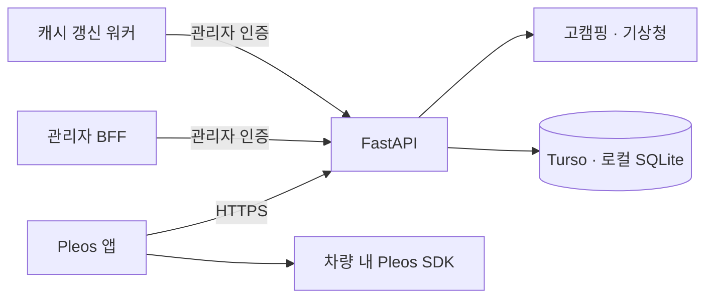

# 서버 구조

캠프룸은 차량 안의 Kotlin·Jetpack Compose 앱과 FastAPI 서버로 구성된다. 앱은 Pleos SDK의 차량 관측과 서버의 캠핑장·날씨·여행 정보를 하나의 준비 흐름으로 연결한다.

## 연결 구조

## 구성별 역할

| 구성 | 역할 |
| --- | --- |
| Kotlin·Compose 앱 | 캠핑장 탐색, 현재 여행, 단계별 준비와 차박 화면 |
| Pleos SDK 어댑터 | 차량 관측·위치·경로·음성을 앱의 공통 계약에 연결 |
| FastAPI | 공급자 데이터 조회, 검색·여행 저장과 주문 시뮬레이션 처리 |
| Turso·SQLite | 같은 관계형 스키마로 캠핑장·현재 여행·상품·주문·갱신 이력 저장 |
| Next.js 관리자 BFF | 서명된 로그인 세션으로 운영 화면과 관리 API 연결 |
| Python 워커 | 인증된 관리 API를 호출해 공유 캠핑장·날씨 캐시 갱신 |

## 데이터 흐름

고캠핑·기상청 어댑터가 장소와 예보를 가져오고 API가 앱에 검색 결과·상세·여행 정보를 전달한다. 앱과 서버는 OpenAPI 기반 요청·응답 계약을 공유한다.

차량 관측은 앱의 로컬 SDK 어댑터가 읽는다. 도착·체류·출발의 준비 상태와 다음 여행 목록은 앱 로컬 저장소에서 관리한다. 서버 데이터의 관계와 키는 [ERD](../database/ERD.md)에 정리했다.

관리자 BFF는 서명 세션을 확인하고 서버에 보관한 토큰으로 API를 호출한다. 워커도 같은 관리 API로 갱신을 요청해 공급자 처리와 저장을 서버에 모은다. 자격증명은 서버 환경변수와 비공개 설정으로 관리한다.

실행 절차는 [README](../../README.md#실행-방법), 관리자 설정은 [인증 안내](../AUTH.ko.md)를 따른다.
