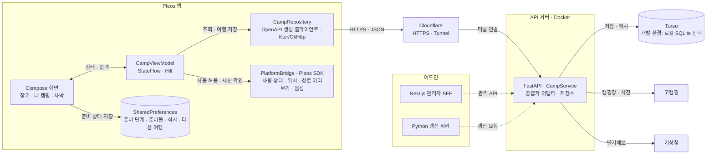

# 캠프룸 아키텍처

캠프룸은 Kotlin·Jetpack Compose로 구현한 Pleos 앱과 FastAPI 서버로 구성된다. 앱은 차량 상태와 캠핑장·날씨·여행 정보를 준비 흐름에 연결한다.

## 연결 구조

[PNG 이미지](../assets/camp-room-architecture.png) · [SVG 원본](../assets/camp-room-architecture.svg)

## 구성별 역할

| 구성 | 역할 |
| --- | --- |
| Pleos 앱 | 캠핑장 탐색, 현재 여행, 단계별 준비와 차박 화면 |
| Pleos SDK 어댑터 | 차량 상태·위치·경로·음성을 앱의 공통 계약에 연결 |
| FastAPI | 공급자 데이터 조회, 검색·여행 저장과 주문 시뮬레이션 처리 |
| Turso·SQLite | 같은 관계형 스키마로 캠핑장·현재 여행·상품·주문·갱신 이력 저장 |
| Next.js 관리자 BFF | 서명된 로그인 세션으로 운영 화면과 관리 API 연결 |
| Python 워커 | 인증된 관리 API를 호출해 공유 캠핑장·날씨 캐시 갱신 |

## 데이터 흐름

고캠핑·기상청 어댑터가 장소와 예보를 가져오고 API가 앱에 검색 결과·상세·여행 정보를 전달한다. 앱과 서버는 OpenAPI 기반 요청·응답 계약을 공유한다.

차량 상태는 앱의 로컬 SDK 어댑터가 읽는다. 전면 실행 여부와 CarUx의 화면 사용 허용 상태, 요청 세션을 확인한 뒤 조회한다.

준비 화면은 SharedPreferences에 도착·체류·출발 단계, 준비물과 식사 선택, 다음 여행 목록을 저장한다. 캠핑장·일정 등 여행 정보는 CampRepository와 생성된 API 클라이언트를 통해 서버에 저장한다. 서버 데이터의 관계와 키는 [ERD](../database/ERD.md)에 정리했다.

관리자 BFF는 서명 세션을 확인하고 서버에 보관한 토큰으로 API를 호출한다. 워커도 같은 관리 API로 갱신을 요청해 공급자 처리와 저장을 서버에 모은다. 관리자와 워커는 API와 별도로 실행한다. 자격증명은 서버 환경변수와 비공개 설정으로 관리한다.

## 선발 후 서비스 확장

선발 후에는 Azure Cloud로 서비스를 확장할 계획이다. 컨테이너 운영, 데이터 저장, 예약 실행과 파일 저장을 나눠 이용 규모에 맞춰 확장한다.

| 구성 | Azure 서비스 | 역할 |
| --- | --- | --- |
| API·어드민 | [Azure Container Apps](https://learn.microsoft.com/en-us/azure/container-apps/overview) | FastAPI와 관리자 BFF의 컨테이너 운영 |
| 데이터베이스 | [Azure Database for PostgreSQL Flexible Server](https://learn.microsoft.com/en-us/azure/postgresql/overview) | 여행·운영 데이터 저장 |
| 스케줄러 | [Azure Container Apps Jobs](https://learn.microsoft.com/en-us/azure/container-apps/jobs) | 캐시 갱신 워커 예약 실행 |
| 오브젝트 스토리지 | [Azure Blob Storage](https://learn.microsoft.com/en-us/azure/storage/blobs/storage-blobs-introduction) | 이미지·파일 저장 |

기존 데이터와 저장소 구현은 PostgreSQL에 맞춰 단계적으로 이전한다. 차량 SDK 연결과 기기에 저장하는 준비 상태는 Pleos 앱에서 처리한다.

실행 절차는 [README](../../README.md#실행-방법), 관리자 설정은 [인증 안내](../AUTH.ko.md)를 따른다.
