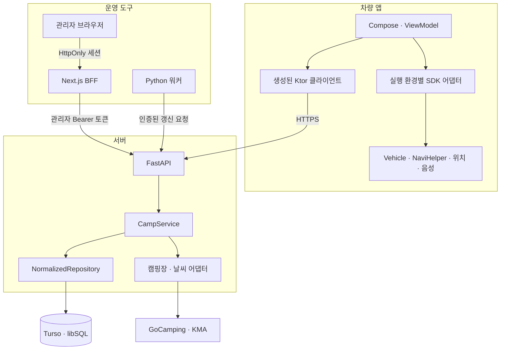
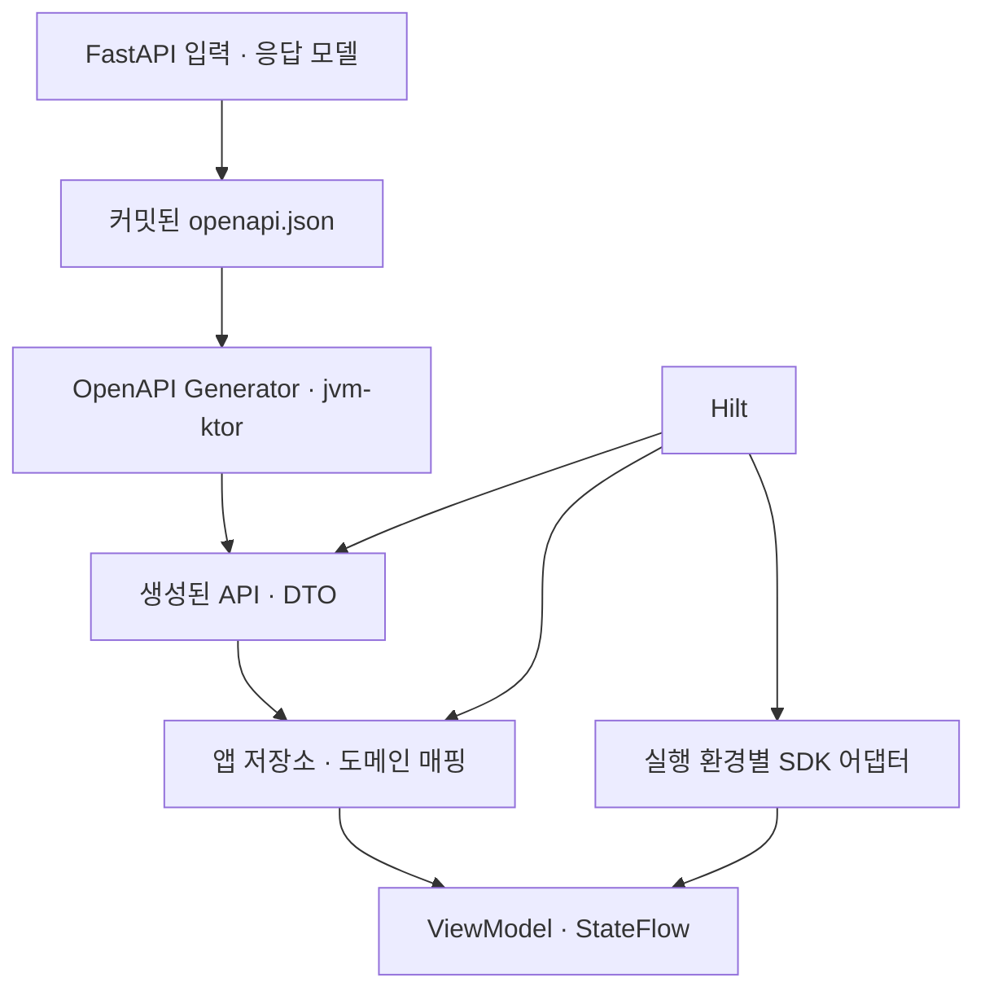
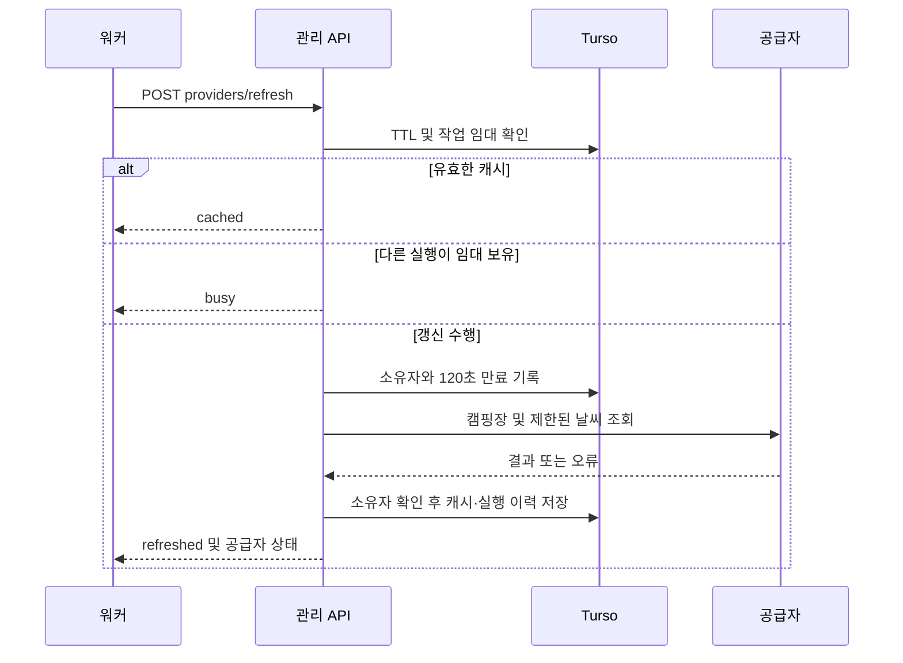

# 서버 구조

캠프룸의 사용자 화면은 차량 안의 Kotlin·Jetpack Compose 앱이다. 서버는 캠핑장·날씨·여행·상품·주문을 처리한다. 차량 제어, 내비, 위치와 음성은 `pleos` 실행 환경의 로컬 SDK 어댑터가 맡는다.

구현 근거는 [API 진입점](../../apps/api/app/main.py), [서비스](../../apps/api/app/service.py), [관계형 저장소](../../apps/api/app/relational.py), [워커](../../apps/worker/src/camp_room_worker/runner.py), [관리자 BFF](../../apps/admin/src/lib/admin-server.ts)다.

## 앱과 서버의 연결

실제 차량의 SDK 호출은 서버를 거치지 않는다. `demo` 실행 환경은 차량·내비 요청을 명시적인 API 시뮬레이터에 보내며 기기의 위치·음성 서비스는 Android 어댑터로 연결한다. 이 구분은 화면이 사용하는 `PlatformBridge` 경계에 모여 있다.

관리자 브라우저는 서버 BFF에만 요청한다. BFF는 서명된 세션을 확인하고 서버에 보관한 관리자 토큰으로 FastAPI를 호출한다. 워커도 같은 관리 API의 캐시 갱신 경로를 사용한다. 워커에 SQL이나 공급자 호출 코드를 복제하지 않는다.

## API 계약과 의존성

`apps/api/scripts/export_openapi.py`가 OpenAPI를 내보내고 `--check`는 커밋된 계약과 현재 모델이 일치하는지 확인한다. Gradle의 `openApiGenerate` 결과는 `apps/pleos/api-client`가 컴파일한다. 생성된 DTO를 소비하는 앱 저장소가 화면용 도메인 모델로 변환한다.

OpenAPI Generator 7.26.0의 `kotlin`/`jvm-ktor`와 `kotlinx_serialization`을 사용한다. Ktor의 `ContentNegotiation`에 JSON 설정을 주입하며 템플릿을 별도로 복제하지 않는다. 숫자·불리언을 허용하는 API 값은 `JsonPrimitive`로 매핑한다. Hilt는 네트워크 객체와 ViewModel, 해당 실행 환경의 SDK 연결을 주입한다.

## 캐시 갱신과 동시 실행

캠핑장 캐시는 600초, 날씨 캐시는 300초 동안 유효하다. 한 번의 배치는 현재 여행과 최대 두 곳의 대안 캠핑장 날씨를 조회한다. 만료된 임대 소유자는 새 결과를 덮어쓰지 못한다. 공급자 장애가 발생해도 마지막 성공 캐시와 실행 이력은 남긴다. 보관된 정보에는 갱신 시각과 장애 상태를 표시한다.

워커는 네트워크 오류, HTTP 429와 5xx를 최대 세 번 재시도한다. 인증 오류와 잘못된 응답은 즉시 실패한다. `refreshed` 응답이라도 공급자 상태가 `fallback` 또는 `unavailable`이면 종료 코드 1로 알린다. DB에 갱신 이력을 저장한 사실과 실시간 데이터를 확보한 사실을 구분하기 위한 동작이다.

## 저장과 주문

Turso와 로컬 SQLite는 같은 32개 STRICT 테이블을 사용한다. 서버 응답을 조립하는 임시 딕셔너리는 저장할 JSON 문서가 아니다. 저장소는 변경한 열과 관계만 갱신한다. 전체 관계와 키는 [ERD](../database/ERD.md)에 있다.

주문은 한 쓰기 트랜잭션에서 현재 재고·멱등 키를 다시 확인하고 재고 차감, 주문·항목·배송 정보·멱등 키 저장, 장바구니 비우기를 함께 처리한다. 모든 SQL 결과를 확인한 다음 COMMIT을 전송한다. 응답이 유실되어 결과를 모르는 경우에는 같은 주문 키로 재조회·재요청해 이미 저장한 주문을 찾는다.

## 설정과 인증 범위

| 위치 | 보관하는 설정 |
| --- | --- |
| Android 빌드 | 공개 가능한 API 주소, 실행 환경 |
| 관리자 브라우저 | HttpOnly 세션 쿠키, 화면 상태 |
| 관리자 서버 | 관리자 비밀번호, 세션 서명 키, API 관리자 토큰 |
| API 서버 | Turso URL·토큰, 공급자 키, 데이터 모드와 저장 범위 |
| 워커 | API 주소, 서버용 관리자 토큰, 간격·타임아웃 |

실제 값은 서버 환경변수나 Git에서 제외한 `.env`에 둔다. `scope_id`와 `profile_id`는 저장소의 데이터 구분 키다. 사용자 로그인이나 접근권한 확인을 대신하지 않는다. 현재 앱 API는 서버가 선택한 데모 프로필을 사용하며 관리자 경로에만 별도의 인증이 적용된다. 인증 동작은 [인증 문서](../AUTH.ko.md)에 정리했다.

## 앱 관측 정보

차량 앱의 진단 이벤트는 로컬 앱 전용 파일에 저장한다. 외부 전송을 켜고 수집 키를 설정한 경우에만 Sentry·PostHog 경로가 활성화된다. 이 경로는 캠핑장·주문 API와 별개이며 원문 위치·음성·주문 데이터를 이벤트에 넣지 않는다. 설정과 수집 범위는 [앱 진단과 분석](../OBSERVABILITY.md)을 따른다.
