# DB ERD

기준은 [001_normalized.sql](../../apps/api/app/migrations/001_normalized.sql)의 32개 STRICT 테이블이다. 같은 스키마를 Turso와 로컬 SQLite에 적용한다. 아래 그림은 영역별 기본 키·외래 키와 관계를 보여주며 모든 열과 CHECK 조건의 원문은 SQL 파일을 따른다.

`PK`는 기본 키, `FK`는 외래 키다. 같은 테이블의 여러 PK 열은 하나의 복합 키다. 실선은 외래 키가 자식 기본 키에 포함되는 관계, 점선은 그 밖의 관계다. 자식 행은 아직 없을 수 있으므로 부모 쪽에서 보는 수는 0개 이상 또는 0~1개로 표시한다. nullable 외래 키는 부모가 없어도 된다.

## 전체 테이블과 키

| 테이블 | 기본 키 | 외래 키 대상 | 저장하는 사실 |
| --- | --- | --- | --- |
| `cr_availability_queries` | `scope_id + campsite_id + check_in + check_out + guests + slot_type` | `scope_id + provider_id` → `cr_providers`; `scope_id + campsite_id` → `cr_campsites` | 날짜·인원별 가용성 조회 |
| `cr_campsite_availability_overviews` | `scope_id + campsite_id` | `scope_id + provider_id` → `cr_providers`; `scope_id + campsite_id` → `cr_campsites` | 일반 가용성·데모 표시 |
| `cr_campsite_facilities` | `scope_id + campsite_id + facility_code` | `facility_code` → `cr_facilities`; `scope_id + campsite_id` → `cr_campsites` | 캠핑장과 시설의 연결 |
| `cr_campsite_rules` | `scope_id + campsite_id + position` | `scope_id + campsite_id` → `cr_campsites` | 캠핑장 운영 규칙 |
| `cr_campsites` | `scope_id + campsite_id` | `scope_id + provider_id` → `cr_providers` | 현재 캠핑장 정보 |
| `cr_cart_items` | `scope_id + profile_id + product_id` | `scope_id + product_id` → `cr_products`; `scope_id + profile_id` → `cr_carts` | 장바구니 상품·수량 |
| `cr_carts` | `scope_id + profile_id` | `scope_id + profile_id` → `cr_profiles` | 프로필별 장바구니 |
| `cr_facilities` | `code` | 없음 | 시설 코드 |
| `cr_idempotency_keys` | `scope_id + profile_id + request_key` | `scope_id + profile_id + order_id` → `cr_orders` | 요청 키·지문·주문 연결 |
| `cr_inventory` | `scope_id + product_id` | `scope_id + product_id` → `cr_products` | 상품별 가용 재고 |
| `cr_order_deliveries` | `scope_id + order_id` | `scope_id + campsite_id` → `cr_campsites`; `scope_id + order_id` → `cr_orders` | 주문 당시 배송지와 체류 기간 |
| `cr_order_fulfillment` | `scope_id + order_id` | `scope_id + order_id` → `cr_orders` | 운영자의 처리 상태·메모 |
| `cr_order_items` | `scope_id + order_id + line_number` | `scope_id + product_id` → `cr_products`; `scope_id + order_id` → `cr_orders` | 주문 당시 상품명·가격·수량 |
| `cr_order_receiving_conditions` | `scope_id + order_id + position` | `scope_id + order_id` → `cr_orders` | 주문 당시 수령 조건 |
| `cr_orders` | `scope_id + order_id` | `scope_id + profile_id` → `cr_profiles` | 주문 공통 정보 |
| `cr_products` | `scope_id + product_id` | `scope_id` → `cr_scopes` | 현재 상품 카탈로그 |
| `cr_profiles` | `scope_id + profile_id` | `scope_id` → `cr_scopes` | 범위 안의 데모 프로필 |
| `cr_provider_runs` | `scope_id + provider_id` | `scope_id + provider_id` → `cr_providers` | 공급자별 최신 상태·만료·모드 |
| `cr_providers` | `scope_id + provider_id` | `scope_id` → `cr_scopes` | 공급자 이름과 종류 |
| `cr_receiving_policies` | `scope_id + campsite_id` | `scope_id + campsite_id` → `cr_campsites` | 현재 택배 수령 정책 |
| `cr_refresh_leases` | `scope_id + job_key` | `scope_id` → `cr_scopes` | 작업별 현재 임대 소유자 |
| `cr_refresh_runs` | `scope_id + run_id` | `scope_id + provider_id` → `cr_providers`; `scope_id` → `cr_scopes` | 갱신 실행 이력 |
| `cr_saved_scene_zones` | `scope_id + profile_id + scene_id + zone_id` | `zone_id` → `cr_zones`; `scope_id + profile_id + scene_id` → `cr_saved_scenes` | 장면별 구역 설정 |
| `cr_saved_scenes` | `scope_id + profile_id + scene_id` | `scope_id + profile_id` → `cr_profiles` | 저장한 차박 장면 |
| `cr_schema_migrations` | `version` | 없음 | 적용한 스키마 버전 |
| `cr_scopes` | `scope_id` | 없음 | 데이터 저장 범위 |
| `cr_trips` | `scope_id + profile_id` | `scope_id + campsite_id` → `cr_campsites`; `scope_id + profile_id` → `cr_profiles` | 프로필의 현재 여행 |
| `cr_vehicle_states` | `scope_id + profile_id` | `scope_id + profile_id + last_scene_id` → `cr_saved_scenes`; `scope_id + profile_id` → `cr_profiles` | 프로필의 차량 시뮬레이터 상태 |
| `cr_vehicle_zones` | `scope_id + profile_id + zone_id` | `zone_id` → `cr_zones`; `scope_id + profile_id` → `cr_vehicle_states` | 차량 시뮬레이터 구역 상태 |
| `cr_weather_forecasts` | `scope_id + query_key + forecast_time` | `scope_id + query_key` → `cr_weather_queries` | 시간별 예보 |
| `cr_weather_queries` | `scope_id + query_key` | `scope_id + provider_id` → `cr_providers`; `scope_id + campsite_id` → `cr_campsites` | 장소·체류 기간별 날씨 캐시 |
| `cr_zones` | `zone_id` | 없음 | 앞·뒤 구역 코드 |

`cr_schema_migrations`는 전체 DB의 버전 이력으로 다른 테이블과 외래 키 관계가 없다. 나머지 그림에서 저장 범위 관계가 생략된 경우에는 위 표와 SQL의 복합 외래 키를 따른다.

## 1. 저장 범위와 공급자

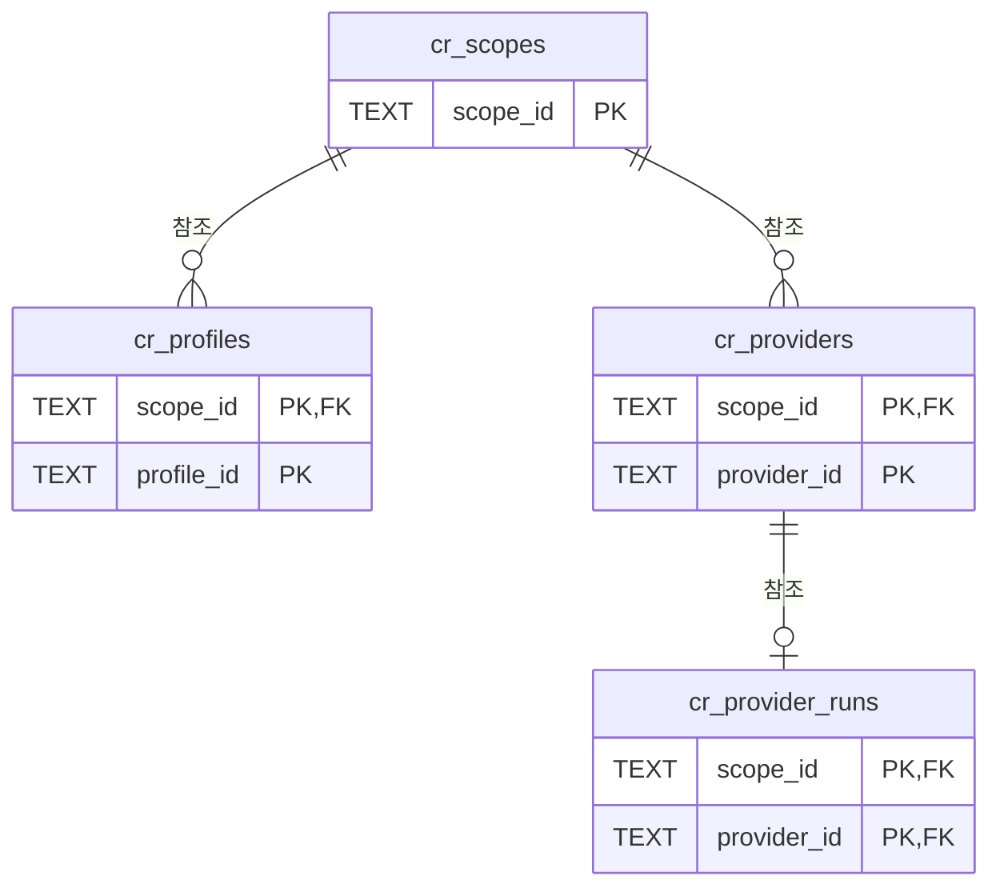

## 2. 캠핑장 시설과 규칙

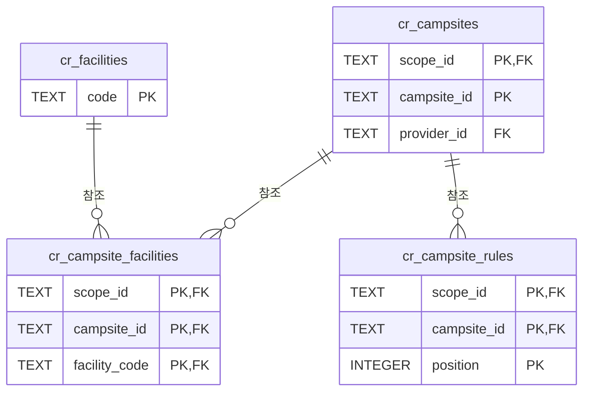

## 3. 수령 정책과 가용성

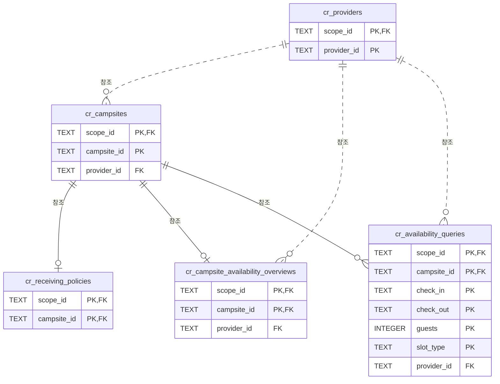

## 4. 현재 여행

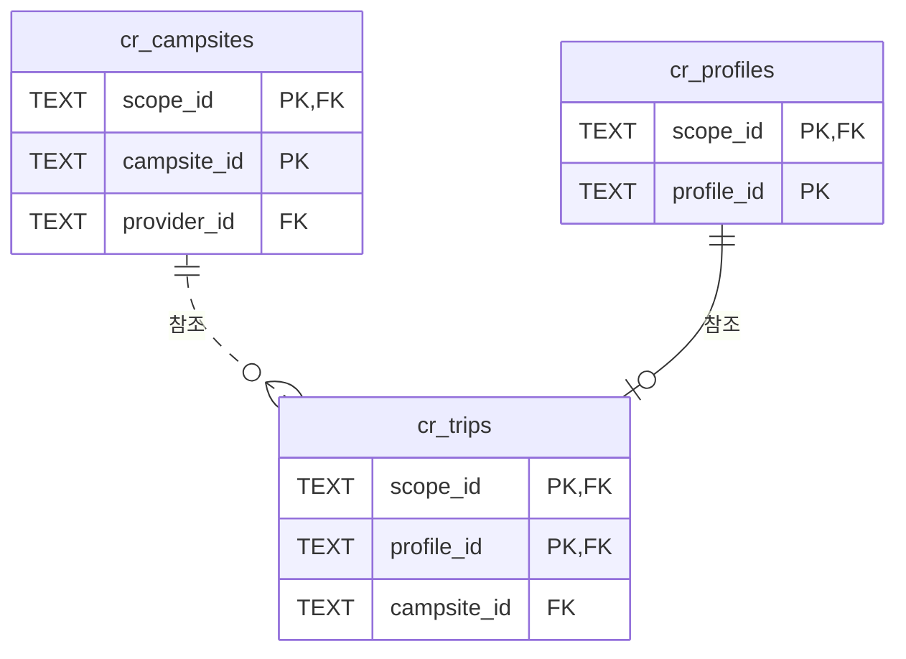

## 5. 저장한 장면

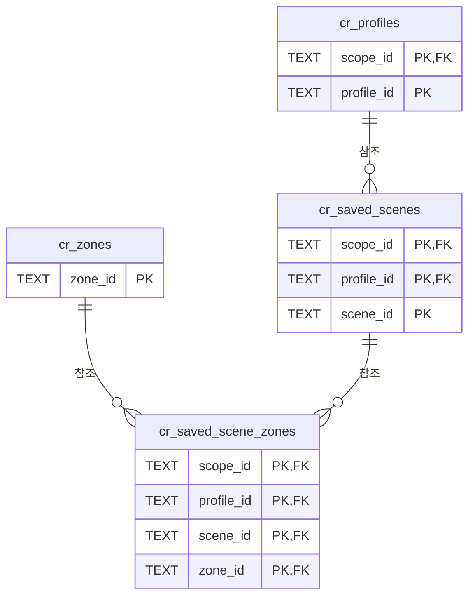

## 6. 차량 시뮬레이터

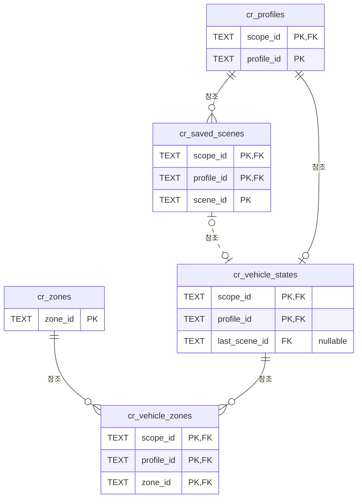

## 7. 상품·재고·장바구니

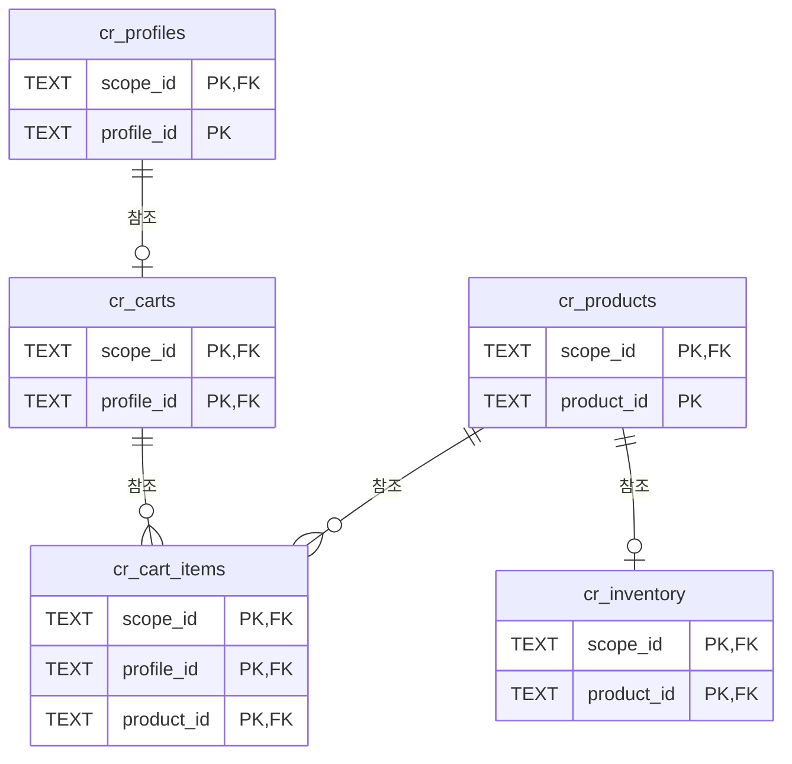

## 8. 주문과 멱등 키

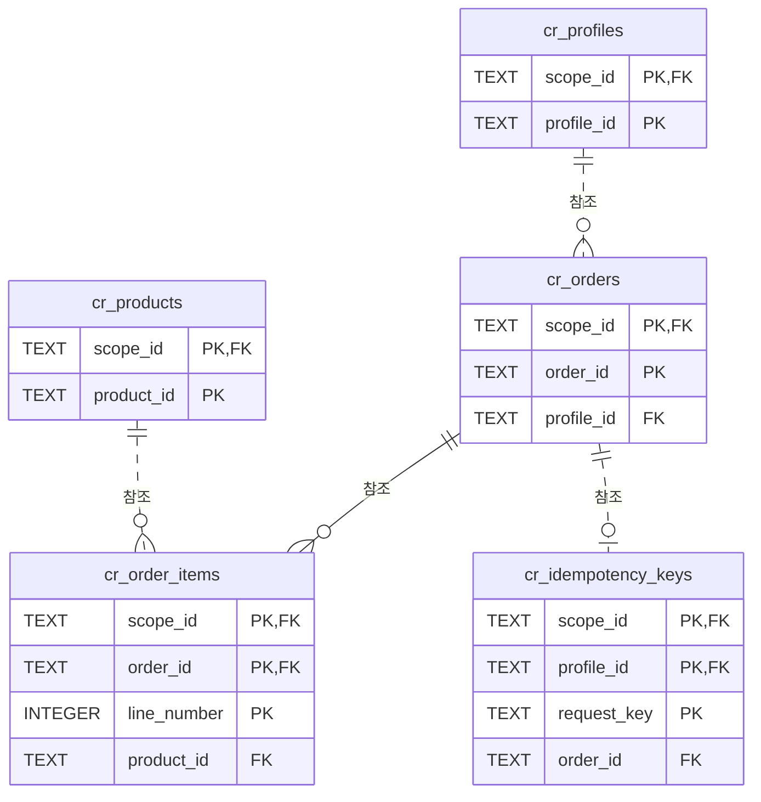

## 9. 배송과 운영 처리

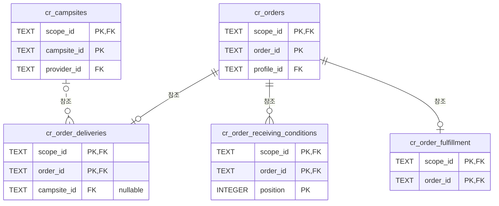

## 10. 날씨 캐시

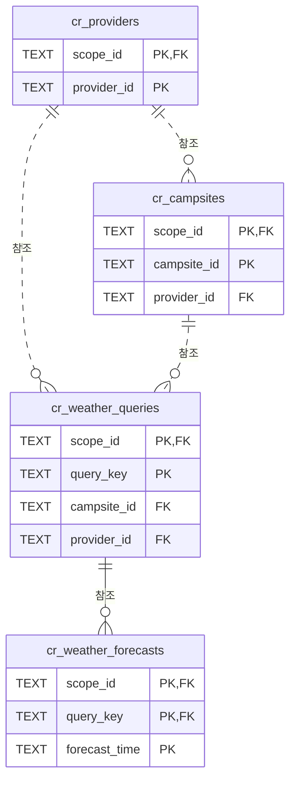

## 11. 배치 임대와 이력

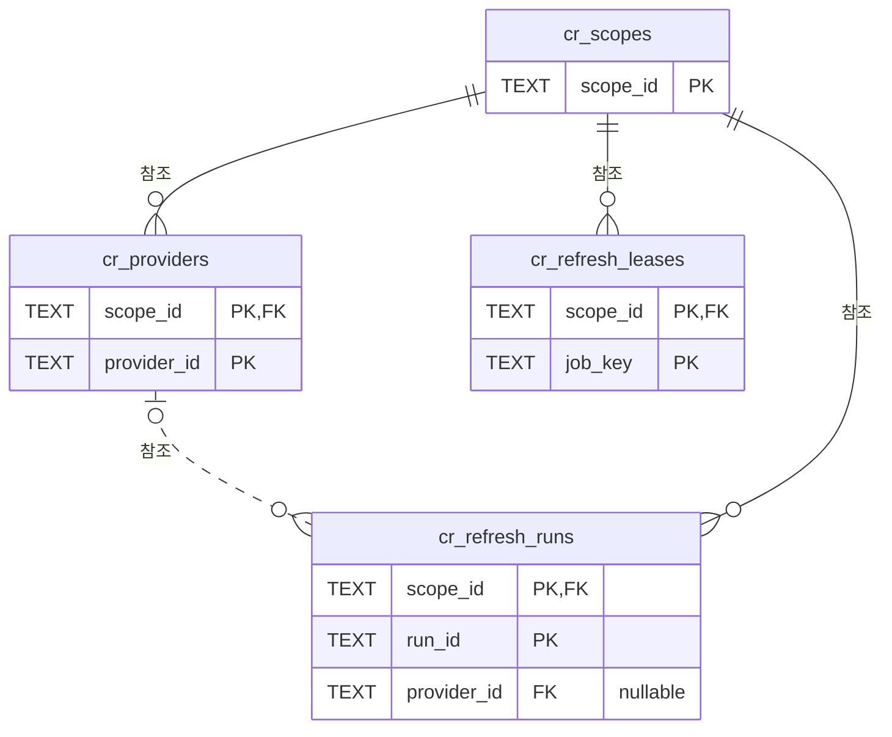

## 키와 이력 해석

- `cr_trips`는 프로필마다 현재 여행을 하나만 저장한다. 여행 이력을 모두 보관하는 모델이 아니다.
- 날짜별 가용성 키에는 저장 범위·캠핑장·체크인·체크아웃·인원·사이트 종류가 들어간다. 일반 가용성 표시를 날짜별 실제 재고로 사용하지 않는다. 알 수 없는 잔여 수는 NULL이다.
- `cr_weather_queries`에는 `(scope_id, campsite_id, check_in, check_out)` 고유 제약이 있다. `query_key`는 장소와 기간에서 계산하며 `variant`는 키에 포함하지 않는다. 데모·실제·설정 상태가 바뀌면 같은 조회의 캐시를 교체한다.
- `cr_orders`의 `(scope_id, profile_id, order_id)`는 추가 고유 키다. 멱등 키의 외래 키가 같은 프로필의 주문만 가리키도록 한다. `cr_idempotency_keys`는 이 주문 조합에도 고유 제약을 둔다.
- 주문 항목은 `(scope_id, order_id, product_id)`도 고유하다. 주문 당시 상품명·가격·주소·수령 조건은 과거의 사실이며 현재 카탈로그에서 다시 가져오지 않는다. 주문 합계는 항목과 배송료에서 계산한다.
- `cr_vehicle_states`는 `mode='demo'`만 허용한다. 실제 차량의 상태 저장이나 제어 명령 큐가 아니다. `last_scene_id`는 없을 수 있다.
- `cr_refresh_leases`는 현재 소유권이고 `cr_refresh_runs`는 실행 이력이다. `run`의 공급자는 전체 갱신 작업이면 NULL일 수 있다. 두 테이블을 직접 연결하는 외래 키는 없다.

금액과 재고는 정수이며 음수를 허용하지 않는다. 체류 기간은 1~30박이고 캠핑장 배송 ETA는 체크인 이상·체크아웃 미만이어야 한다. FK·STRICT·CHECK 검증과 주문 원자성의 근거는 [독립 DB 검토](SCHEMA_REVIEW.md)에 기록했다.

이 ERD의 관계와 키는 실제 DDL을 메모리 SQLite에 적용한 뒤 `table_info`, `foreign_key_list`, `index_list`로 대조했다. Mermaid 표기는 [공식 ER 문법](https://mermaid.js.org/syntax/entityRelationshipDiagram.html)을 따른다.
