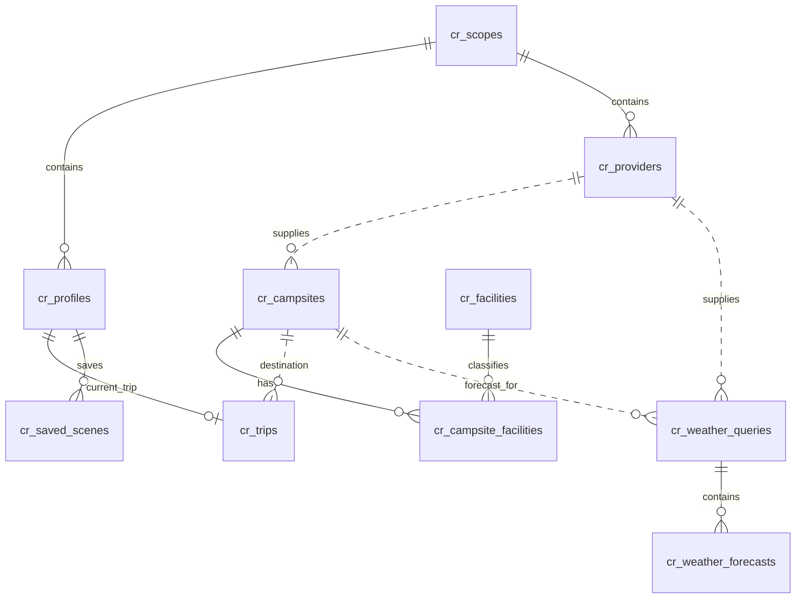

# DB ERD

기준은 [001_normalized.sql](../../apps/api/app/migrations/001_normalized.sql)의 32개 STRICT 테이블이다. 같은 스키마를 Turso와 로컬 SQLite에 적용한다. 아래 표는 전체 테이블의 키와 역할을, 그림은 핵심 여행 데이터의 관계를 보여준다.

`PK`는 기본 키, `FK`는 외래 키다. 같은 테이블의 여러 PK 열은 하나의 복합 키다. 실선은 외래 키가 자식 기본 키에 포함되는 관계, 점선은 그 밖의 관계다. 자식 행의 수는 0개 이상 또는 0~1개로 표시하며 nullable 외래 키는 NULL을 허용한다.

## 전체 테이블과 키

| 테이블 | 기본 키 | 외래 키 대상 | 저장하는 사실 |
| --- | --- | --- | --- |
| `cr_availability_queries` | `scope_id + campsite_id + check_in + check_out + guests + slot_type` | `scope_id + provider_id` → `cr_providers`; `scope_id + campsite_id` → `cr_campsites` | 날짜·인원별 가용성 조회 |
| `cr_campsite_availability_overviews` | `scope_id + campsite_id` | `scope_id + provider_id` → `cr_providers`; `scope_id + campsite_id` → `cr_campsites` | 일반 가용성·데모 표시 |
| `cr_campsite_facilities` | `scope_id + campsite_id + facility_code` | `facility_code` → `cr_facilities`; `scope_id + campsite_id` → `cr_campsites` | 캠핑장과 시설의 연결 |
| `cr_campsite_rules` | `scope_id + campsite_id + position` | `scope_id + campsite_id` → `cr_campsites` | 캠핑장 운영 규칙 |
| `cr_campsites` | `scope_id + campsite_id` | `scope_id + provider_id` → `cr_providers` | 현재 캠핑장 정보 |
| `cr_cart_items` | `scope_id + profile_id + product_id` | `scope_id + product_id` → `cr_products`; `scope_id + profile_id` → `cr_carts` | 장바구니 상품·수량 |
| `cr_carts` | `scope_id + profile_id` | `scope_id + profile_id` → `cr_profiles` | 프로필별 장바구니 |
| `cr_facilities` | `code` | 없음 | 시설 코드 |
| `cr_idempotency_keys` | `scope_id + profile_id + request_key` | `scope_id + profile_id + order_id` → `cr_orders` | 요청 키·지문·주문 연결 |
| `cr_inventory` | `scope_id + product_id` | `scope_id + product_id` → `cr_products` | 상품별 가용 재고 |
| `cr_order_deliveries` | `scope_id + order_id` | `scope_id + campsite_id` → `cr_campsites`; `scope_id + order_id` → `cr_orders` | 주문 당시 배송지와 체류 기간 |
| `cr_order_fulfillment` | `scope_id + order_id` | `scope_id + order_id` → `cr_orders` | 운영자의 처리 상태·메모 |
| `cr_order_items` | `scope_id + order_id + line_number` | `scope_id + product_id` → `cr_products`; `scope_id + order_id` → `cr_orders` | 주문 당시 상품명·가격·수량 |
| `cr_order_receiving_conditions` | `scope_id + order_id + position` | `scope_id + order_id` → `cr_orders` | 주문 당시 수령 조건 |
| `cr_orders` | `scope_id + order_id` | `scope_id + profile_id` → `cr_profiles` | 주문 공통 정보 |
| `cr_products` | `scope_id + product_id` | `scope_id` → `cr_scopes` | 현재 상품 카탈로그 |
| `cr_profiles` | `scope_id + profile_id` | `scope_id` → `cr_scopes` | 범위 안의 데모 프로필 |
| `cr_provider_runs` | `scope_id + provider_id` | `scope_id + provider_id` → `cr_providers` | 공급자별 최신 상태·만료·모드 |
| `cr_providers` | `scope_id + provider_id` | `scope_id` → `cr_scopes` | 공급자 이름과 종류 |
| `cr_receiving_policies` | `scope_id + campsite_id` | `scope_id + campsite_id` → `cr_campsites` | 현재 택배 수령 정책 |
| `cr_refresh_leases` | `scope_id + job_key` | `scope_id` → `cr_scopes` | 작업별 현재 임대 소유자 |
| `cr_refresh_runs` | `scope_id + run_id` | `scope_id + provider_id` → `cr_providers`; `scope_id` → `cr_scopes` | 갱신 실행 이력 |
| `cr_saved_scene_zones` | `scope_id + profile_id + scene_id + zone_id` | `zone_id` → `cr_zones`; `scope_id + profile_id + scene_id` → `cr_saved_scenes` | 장면별 구역 설정 |
| `cr_saved_scenes` | `scope_id + profile_id + scene_id` | `scope_id + profile_id` → `cr_profiles` | 저장한 차박 장면 |
| `cr_schema_migrations` | `version` | 없음 | 적용한 스키마 버전 |
| `cr_scopes` | `scope_id` | 없음 | 데이터 저장 범위 |
| `cr_trips` | `scope_id + profile_id` | `scope_id + campsite_id` → `cr_campsites`; `scope_id + profile_id` → `cr_profiles` | 프로필의 현재 여행 |
| `cr_vehicle_states` | `scope_id + profile_id` | `scope_id + profile_id + last_scene_id` → `cr_saved_scenes`; `scope_id + profile_id` → `cr_profiles` | 프로필의 차량 시뮬레이터 상태 |
| `cr_vehicle_zones` | `scope_id + profile_id + zone_id` | `zone_id` → `cr_zones`; `scope_id + profile_id` → `cr_vehicle_states` | 차량 시뮬레이터 구역 상태 |
| `cr_weather_forecasts` | `scope_id + query_key + forecast_time` | `scope_id + query_key` → `cr_weather_queries` | 시간별 예보 |
| `cr_weather_queries` | `scope_id + query_key` | `scope_id + provider_id` → `cr_providers`; `scope_id + campsite_id` → `cr_campsites` | 장소·체류 기간별 날씨 캐시 |
| `cr_zones` | `zone_id` | 없음 | 앞·뒤 구역 코드 |

`cr_schema_migrations`는 전체 DB의 버전 이력을 독립적으로 관리한다. 그림의 저장 범위 관계는 위 표와 SQL의 복합 외래 키를 따른다.

## 주요 관계

## 저장 원칙

- 프로필마다 현재 여행 하나를 저장하고 선택한 캠핑장·일정·인원을 연결한다.
- 시설·규칙·예보·주문 항목은 각각의 관계로 저장한다. 날짜별 가용성과 날씨는 장소·체류 기간을 기준으로 관리한다.
- 주문 당시 상품명·가격·주소·수령 조건은 스냅샷으로 보존한다. 합계는 항목과 배송료에서 계산한다.
- 서버 차량 상태는 개발용 시뮬레이터로 관리하고, 앱의 차량 관측은 Pleos SDK에서 읽는다.
- 금액과 재고는 0 이상의 정수이며 복합 외래 키가 같은 저장 범위의 데이터를 연결한다.

## 데이터 일관성

주문은 재고 확인·차감, 주문·배송·멱등 키 저장과 장바구니 정리를 하나의 트랜잭션으로 처리한다. 같은 요청 키를 재사용해 주문의 일관성을 유지한다.

공급자 갱신은 작업 소유권을 확인한 뒤 캐시와 실행 이력을 함께 저장한다. 열·키·제약조건은 위의 SQL 스키마를 기준으로 한다.
